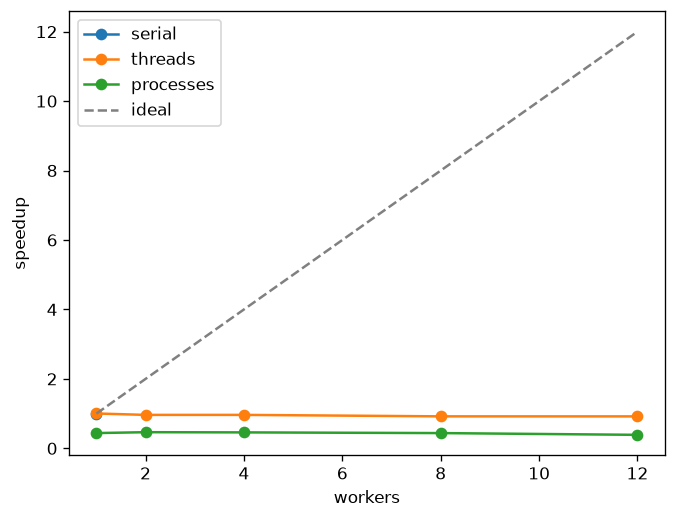
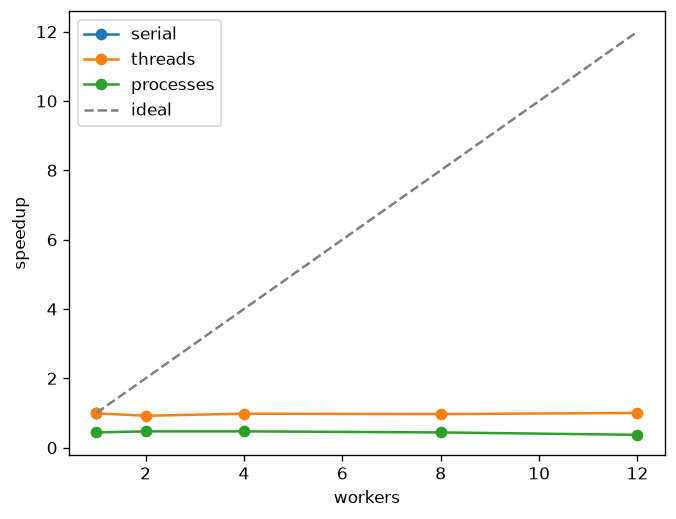

# findex — lab 05


Continues lab 04’s installable CLI. Parallel index build over **15** Gutenberg
documents (Alice chapters + Frankenstein + Pride & Prejudice).

```bash
uv sync --all-groups
findex index src/resources --out index.pkl --executor serial --workers 1
findex index src/resources --out index.pkl --executor threads --workers 4
findex index src/resources --out index.pkl --executor processes --workers 8
uv run python -m findex.bench          # table + speedup.png
uv run pytest
```

Version **0.5.0**. Default `--executor` is **serial** on this machine (see below).

## Continuity

| lab | adds |
|-----|------|
| 01–03 | corpus → inverted index → ranking |
| 04 | types, pytest, typer/rich CLI |
| 05 | `build_partial` / `merge_partials`, `--workers` / `--executor`, GIL benchmarks |

## Machine

- **CPU:** 13th Gen Intel Core i5-13420H  
- **Cores:** 12 (`os.cpu_count()`)  
- **GIL-on interpreter:** CPython 3.12 (`sys._is_gil_enabled` missing → GIL on)  
- **Free-threaded:** CPython 3.13.15t — `sys._is_gil_enabled()` → `False`

Method: one warmup discarded, then **3 runs**; table cells are **medians**.
Wall = `perf_counter` around `build_parallel`. CPU for threads = parent
`process_time`; for processes = parent + worker CPU returned from each chunk.
Peak RSS = parent working set sampled during the cell. Speedup = serial median
wall ÷ cell wall.

## GIL on (Python 3.12)

| Executor | Workers | Wall (s) | CPU (s) | Peak RSS | Merge (s) | Speedup |
|----------|---------|----------|---------|----------|-----------|---------|
| serial | 1 | 0.213 | 0.203 | 43.2 MiB | 0.005 | 1.00× |
| threads | 1 | 0.212 | 0.203 | 44.9 MiB | 0.005 | 1.00× |
| threads | 2 | 0.221 | 0.203 | 46.1 MiB | 0.006 | 0.96× |
| threads | 4 | 0.221 | 0.219 | 46.2 MiB | 0.007 | 0.96× |
| threads | 8 | 0.231 | 0.219 | 47.4 MiB | 0.016 | 0.92× |
| threads | 12 | 0.231 | 0.219 | 47.8 MiB | 0.015 | 0.92× |
| processes | 1 | 0.484 | 0.266 | 48.6 MiB | 0.017 | 0.44× |
| processes | 2 | 0.457 | 0.266 | 47.2 MiB | 0.018 | 0.47× |
| processes | 4 | 0.463 | 0.266 | 47.3 MiB | 0.020 | 0.46× |
| processes | 8 | 0.484 | 0.297 | 47.4 MiB | 0.019 | 0.44× |
| processes | 12 | 0.547 | 0.297 | 47.5 MiB | 0.018 | 0.39× |



## Free-threaded 3.13t — `sys._is_gil_enabled()` is `False`

| Executor | Workers | Wall (s) | CPU (s) | Peak RSS | Merge (s) | Speedup |
|----------|---------|----------|---------|----------|-----------|---------|
| serial | 1 | 0.255 | 0.266 | 51.0 MiB | 0.005 | 1.00× |
| threads | 1 | 0.257 | 0.266 | 80.1 MiB | 0.007 | 0.99× |
| threads | 2 | 0.277 | 0.297 | 103.5 MiB | 0.008 | 0.92× |
| threads | 4 | 0.260 | 0.297 | 104.2 MiB | 0.009 | 0.98× |
| threads | 8 | 0.263 | 0.328 | 111.1 MiB | 0.011 | 0.97× |
| threads | 12 | 0.255 | 0.297 | 123.9 MiB | 0.009 | 1.00× |
| processes | 1 | 0.579 | 0.359 | 95.9 MiB | 0.007 | 0.44× |
| processes | 2 | 0.547 | 0.375 | 98.0 MiB | 0.007 | 0.47× |
| processes | 4 | 0.540 | 0.391 | 95.3 MiB | 0.008 | 0.47× |
| processes | 8 | 0.585 | 0.469 | 93.5 MiB | 0.008 | 0.44× |
| processes | 12 | 0.680 | 0.531 | 93.6 MiB | 0.008 | 0.37× |



(PNG drawn from the free-threaded medians; 3.13t had no matplotlib wheel here.)

## Why the curves look like this

Indexing this corpus is about **0.2 s** of Python: read files, tokenize with
positions, fill dicts. With the GIL, only one thread runs that bytecode at a
time. Extra threads wait on the lock (~5 ms switch interval). The threads rows
stay at **0.92–1.00×** — no real speedup, a little overhead. CPU time stays next
to wall time: one core is busy.

A process has its own interpreter and its own GIL, so tokenize loops *can*
overlap. On a longer job that pays off. Here the job is short, and **spawn**
starts a fresh interpreter plus pickles paths in and `PartialIndex` objects out.
One process already costs **0.484 s** vs **0.213 s** serial (0.44×). Adding
workers never recovers that tax on this corpus, so processes stay around
**0.4–0.5×**. Parent RSS stays ~47 MiB; the copies live in children.

Merge is **~0.005–0.020 s** — a few percent of serial wall. Amdahl says that
serial tail caps speedup even with infinite cores
(`1 / (f + (1−f)/N)`). On a 0.2 s job the **spawn/pickle tax** hits the ceiling
first; merge is visible as a flat serial residual but is not yet the limiter.

On **3.13.15 free-threaded**, `sys._is_gil_enabled()` is `False`. Single-thread
work is a bit slower than 3.12 (0.255 s vs 0.213 s). Threads still do not beat
serial on *this* short CPU burst (memory / coordination), but they no longer sit
behind one lock — and the race demo changes (below). Processes keep the same
pickle tax (~0.44×).

**Race:** two threads each do `shared += 1` a million times.  
GIL-on 3.12 printed `2000000` (got lucky — still not atomic).  
Free-threaded printed **`1130064`**; with a `Lock`, **`2000000`**.  
`+=` is load / add / store; without the GIL two cores overwrite each other.
The indexer does **not** share that counter: each `build_partial` owns its
dicts; `merge_partials` runs in the parent after the pool returns.

**I/O counter-example:** 60 file reads — GIL-on `serial=0.0170s` /
`threads=0.0203s` (pages cached; decode still holds the GIL). Free-threaded
`serial=0.0134s` / `threads=0.0083s` — threads overlap decode once nothing waits
on the lock.

Because serial won here, **`--executor serial` is the default**. Use
`--executor processes` when the corpus is large enough that tokenize time dwarfs
spawn.

## API sketch

```text
build_partial((paths, start_doc_id, with_positions)) -> PartialIndex   # module-level
split_jobs(paths, workers, with_positions) -> list[ChunkJob]
merge_partials(parts) -> Index
build_parallel(paths, workers, executor, with_positions)
findex index … --workers N --executor {serial,threads,processes}
```

Identity test: `merge_partials([build_partial(all_paths)])` equals lab-04-style
`assemble(...)` (`tests/test_parallel.py`).
