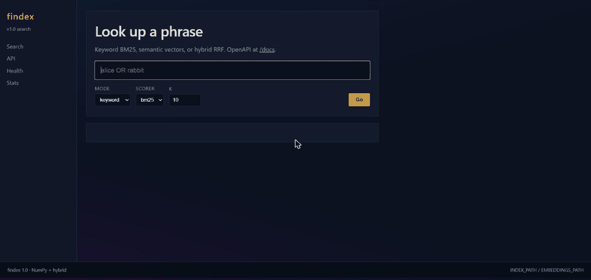
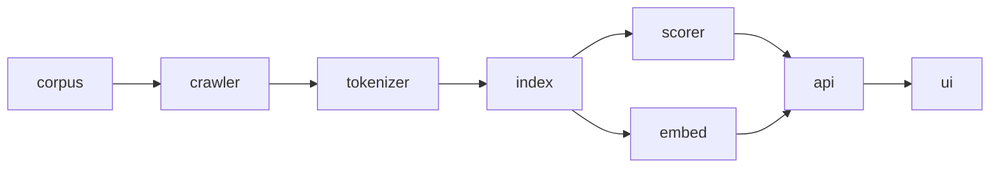

# findex

**Live deploy URL:** https://findex-z347.onrender.com  
(Render free tier: the first request after ~15 min idle takes about a minute while the service wakes up. Health: https://findex-z347.onrender.com/health, API docs: https://findex-z347.onrender.com/docs)

One sentence: a searchable inverted index with NumPy BM25, optional MiniLM
semantics, hybrid RRF, and a FastAPI page anyone can open.

| corpus | single-query latency | largest NumPy speedup |
|---:|---:|---:|
| **15** Gutenberg docs (~11.5k terms) | ~**37 ms** local `/search?q=alice` | **9.9x** on 40k synthetic postings |

Version **1.0.0**. Public GitHub tags: **`lab-08`** and **`v1.0.0`**.

**GIF (search UI on the deployed service):**



**Demo video (~2.5 min, deployed service):** [docs/findex_demo.mp4](docs/findex_demo.mp4)

**Live demo:** open https://findex-z347.onrender.com, type `alice AND rabbit`, mode `keyword`, press Go.



Path: corpus (lab 1) → crawler (lab 6) → tokenizer (labs 1-2) → index/scorer
(labs 2-3, NumPy in lab 8) → embed (lab 8) → API/UI (labs 7-8).

## Run

```bash
uv sync --all-groups
findex index src/resources --out index.pkl
findex search index.pkl "alice rabbit" --backend numpy
findex serve --index index.pkl --port 8000
uv run pytest
uv run python scripts/bench_numpy_scorer.py
```

Semantic / hybrid:

```bash
uv sync --group semantic
findex embed --index index.pkl --out embeddings.npy --model all-MiniLM-L6-v2
findex serve --index index.pkl --embeddings embeddings.npy
```

`mode=keyword|semantic|hybrid` in CLI (`--mode`), API (`?mode=`), and the UI.

## Profile (before NumPy)

`docs/hotspots.md` · `docs/cprofile_search.txt` · flame `docs/search.svg`

Top three hotspots written **before** the NumPy patch:

1. Pickle restore of many `Posting` objects - Python + native pickle.
2. Cold CLI imports - Python; not the API hot path.
3. Snippet disk reads per hit - native I/O + Python strings (NumPy does not fix this).

Postings: int32 doc_ids / tfs, one int32 length vector. BM25/TF-IDF as array
ops, top-k via `np.argpartition`. Ranking matches lab 3
(`tests/test_numpy_ranking.py`). `pytest-benchmark` on search / build_index in CI.

## Consolidated measurements (labs 1-8)

### Lab 1 - streaming vs eager

| mode | docs | tokens | vocab | time (s) | peak (KiB) |
|---|---:|---:|---:|---:|---:|
| streaming | 13 | 29773 | 3130 | 0.0776 | 716.7 |
| eager | 13 | 29773 | 3130 | 0.0533 | 2070.6 |

### Lab 2 - postings memory / merge vs set

| representation | peak (KiB) | pickle (bytes) | load (s) |
|---|---:|---:|---:|
| plain dataclass | 15706.7 | 538067 | 0.0128 |
| slots=True | 15370.7 | 430756 | 0.0382 |
| array('I') pairs | 16123.4 | 659565 | 0.0112 |

| pair | query | engine | mean (s) |
|---|---|---|---:|
| rare | `0 108` | merge | 0.00000085 |
| rare | `0 108` | set | 0.00000100 |
| common | `and the` | merge | 0.00000060 |
| common | `and the` | set | 0.00000059 |

### Lab 3 - BM25 checks + precision@5 mean

Rare `cheshire` (df=1) weight at tf=1: **1.5295** vs `elizabeth` (df=2): **0.5645**.  
Ten labeled queries, TF-IDF and BM25 mean precision@5: **0.20**.

### Lab 4 - packaging

Version **0.4.0**, ~50 pytest, ~92% coverage, pyright strict, CI.

### Lab 5 - GIL (serial wall ~0.21 s on 15 docs)

Threads do not beat serial under GIL on this corpus; processes lose to spawn cost.
Free-threaded 3.13t still no clear win here (short jobs).

### Lab 6 - crawl (`books.toscrape.com`, max_pages=200)

| concurrency | wall (s) | pages/s | peak RSS |
|---:|---:|---:|---|
| 1 | 109.56 | 1.83 | 41.6 MiB |
| 5 | 55.82 | 3.58 | 42.6 MiB |
| 20 | 56.27 | 3.55 | 43.6 MiB |

### Lab 7 - web handlers + load

| mode | 20 concurrent wall |
|---|---:|
| blocking `async def` | 1.22 s |
| `def` (thread pool) | 0.76 s |

Load (`scripts/load_search.py`, c=20, n=200, 1 worker `def`): RPS **13.8**, p50 **1388** ms, p95 **2045** ms, p99 **2217** ms.

Deployed (Render free, 0.1 CPU / 512 MB, browser-side load script, c=20, n=200, `/search?q=alice&k=10`): RPS **16.2**, p50 **1202** ms, p95 **1718** ms, p99 **2006** ms, 0 failures.

### Lab 8 - NumPy speedup

Full table: [`docs/numpy_speedup.md`](docs/numpy_speedup.md)

| Query | Docs matched | Lab 3 loop (ms) | NumPy (ms) | Speedup |
|---|---:|---:|---:|---:|
| common (`the`) | 15 | 0.014 | 0.038 | 0.4x |
| rare (`carroll`) | 1 | 0.004 | 0.031 | 0.1x |
| 3-term (`alice white rabbit`) | 7 | 0.022 | 0.086 | 0.3x |
| synthetic-40k (`common`) | 40000 | 35.486 | 3.583 | **9.9x** |

Tiny lists: overhead dominates (speedup under 1x). Long lists: ufuncs win.

Precision@5 keyword / semantic / hybrid (+ paraphrases): [`docs/precision_at_5.md`](docs/precision_at_5.md).  
Numbers for the semantic/hybrid columns are in that file (computed locally with MiniLM).

## Limitations

- Tiny corpora undersell NumPy; use long posting lists for honest speedups.
- Brute-force `E @ q` is fine under ~1e5 chunks; then HNSW/FAISS.
- Snippets still hit disk unless text is cached at load.
- Without embeddings, semantic/hybrid stay disabled.
- On the Render free tier (512 MB RAM) only `keyword` mode is usable: loading the MiniLM model for `semantic`/`hybrid` exceeds the memory limit. Semantic and hybrid work locally (`findex serve --embeddings deploy/embeddings.npy`).
- py-spy may fail on some Windows hosts - keep the cProfile flame in `docs/`.

## Deploy checklist

See **[DEPLOY.md](DEPLOY.md)** for the full Render setup.

1. Deployed at https://findex-z347.onrender.com (URL at the top of this file).
2. GitHub main must include this code (and ideally deploy/embeddings.npy).
3. Render: Language **Docker**, health /health.
4. Env: INDEX_PATH=/app/deploy/index.pkl, EMBEDDINGS_PATH=/app/deploy/embeddings.npy, LOG_LEVEL=INFO (do not hardcode PORT).
5. Image / release: **v1.0.0**. Git tags: **lab-08**, **1.0.0**.

## Defence (5 minutes)

Prepared talking points:

1. **Live demo** - open https://findex-z347.onrender.com (or local `findex serve`), search keyword then hybrid.
2. **One measurement to show** - NumPy **9.9x** on 40k synthetic postings (`docs/numpy_speedup.md`), and why the 15-doc rows are under 1x.
3. **One bug that taught something** - snippet I/O dominating the profile while BM25 looked "slow" until cProfile separated Python vs disk.
4. **Reflection (pick 2-3):**
   - Why can NumPy lose on a rare term with df=1?
   - Why RRF instead of adding raw BM25 and cosine scores?
   - Which hotspot was Python time vs native I/O in your profile?
   - `cProfile` vs `py-spy` vs Scalene - which attaches to a live process?